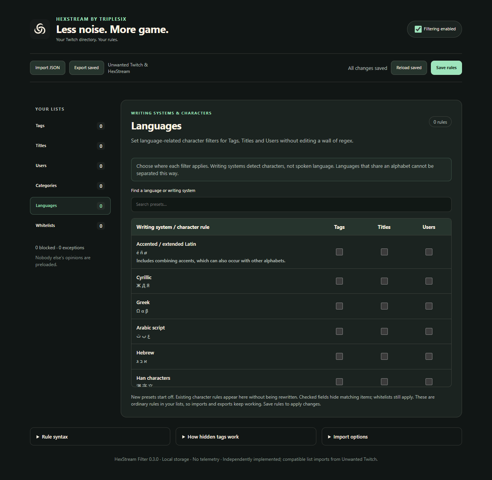

  

  
  
  
  

  <a href="#get-it-running">Install</a> · <a href="docs/FILTERING.md">Rules & languages</a> · <a href="#the-tags-the-damn-card-leaves-out">Hidden tags</a> · <a href="VERIFICATION.md">Testing</a> · <a href="https://github.com/ItsTripleSix/HexStream">Android app</a>

**Your Twitch directory. Your rules. Including the tags the damn card leaves out.**

HexStream Filter is a Firefox-first Twitch filtering extension with a Chrome build. Hide users, categories, titles and tags. Inspect the full tag metadata Twitch supplies. Bring your existing lists. Decide what stays on your screen and get back to the game.

**Lists start empty. Nobody else's opinions come preinstalled.** Current version: **0.3.0**. Firefox is Mozilla-signed for installation from GitHub; Chrome uses an unpacked ZIP. Updates are manual.

> **Want this on your phone?** [HexStream for Android →](https://github.com/ItsTripleSix/HexStream) 
> An Xtra-based Twitch app with global filtering, stable category pagination, saved accounts, playback proxies, swipe controls and low-delay playback. Same project family; separate installations. [Compare the two →](docs/FILTERING.md#using-it-with-hexstream-for-android)

## Why this exists

[Unwanted Twitch](https://github.com/kwaschny/unwanted-twitch) established a damn useful idea: let people remove the channels, games, titles and tags they don't want. Credit to **kwaschny** for that workflow and the compatible export format.

I wanted that kind of control with **full supplied-tag coverage**, a clearer list manager, inspectable filtering decisions and language-related character filters that don't require babysitting a wall of regex. So HexStream Filter was built independently, with its own code, interface and shared HexStream branding. Unwanted Twitch's source and artwork are not bundled.

Ever open a game directory and find a tag war between `MyTeamIsPerfect` and `EveryoneElseIsWrong`? **Cool. I don't give a fuck. I'm here for the game.** Block either, both or neither. Those examples are fictional; the choice belongs to you.

## The tags the damn card leaves out

A stream can have more tags than its card has room to show. Filtering only the visible chips leaves a hole big enough to drive the whole directory through.

HexStream observes **Twitch's existing responses**, keeps the public stream metadata in bounded memory and checks **every supplied tag**. A matching tag can hide a stream even if that tag never appeared as a chip. It does this without opening every stream or adding Twitch API requests.

The inspector tells you what it actually knows:

| Coverage | What it means |
| --- | --- |
| **Full tag metadata received** | Twitch supplied a complete custom-tag list; every tag in that list is checked. |
| **Visible tags only** | Complete metadata has not arrived for this view; filtering uses the evidence available. |

This is not a catalog of every tag on Twitch. Missing metadata cannot be invented. Clips and videos do not borrow a channel's current live tags. [How coverage and navigation stability work →](docs/FILTERING.md#full-tags-and-returning-to-a-directory)

## What you get

| Feature | The useful part |
| --- | --- |
| **Tags, Titles, Users, Categories** | Separate lists, visible tabs, counts and one rule per line. |
| **Languages** | 36 writing-system presets. Choose independently whether each applies to Tags, Titles or Users. |
| **Whitelists** | Always-allow channels plus narrow user, title and tag exceptions. |
| **Bring your lists** | Compatible Unwanted Twitch and HexStream JSON imports, validated before saving. |
| **Card inspector** | A compact ⬡ button shows available tags, metadata coverage and quick blocking actions. Sidebar filtering stays active without extra sidebar buttons. |
| **Why hidden?** | Inspect up to 100 recent matches in the current tab. |
| **Pause** | Restore loaded cards without deleting your rules. |
| **Stable browsing** | Partial player responses, cache expiry and temporary missing chips don't erase a connected card's known full tags. |
| **Less busywork** | Indexed exact rules, a bundled linear-time regex engine, bounded caches and batched updates. Unrelated player/chat changes don't trigger full scans. |
| **Local storage** | Rules stay in your browser profile. No telemetry, extension account or automatic cloud sync. |

<strong>See the Languages page — clean defaults, no personal list</strong>

## Get it running

Download from [Releases](https://github.com/ItsTripleSix/HexStream-Filter/releases). Pick the file for your browser:

| Browser | Download | Installation |
| --- | --- | --- |
| **Firefox 142+** | `HexStream-Filter-0.3.0-firefox-signed.xpi` | Open `about:addons` → gear menu → **Install Add-on From File…** → choose the XPI. |
| **Chrome 120+** | `HexStream-Filter-0.3.0-chrome.zip` | Extract it → open `chrome://extensions` → enable **Developer mode** → **Load unpacked** → choose the extracted folder containing `manifest.json`. |

**Reload your Twitch tabs after installation or an update.** Then open the extension → **Manage your rules**. Add one rule per line, or **Import JSON**, review the lists and **Save rules**. Nothing is blocked until you add rules.

The signed Firefox XPI stays installed after restarting Firefox. The unsigned Firefox ZIP is a development package. Chrome's extracted folder must stay where you loaded it. Neither browser package is currently distributed through a public extension-store listing.

**[Full installation, updating, migration and troubleshooting →](docs/INSTALLING.md)**

## Languages without the regex headache

Open **Manage your rules → Languages**, search for a language or writing system, tick **Tags**, **Titles**, **Users**, or any combination, and save. New presets all start off.

These are **written-character filters**, not spoken-language detection. Languages sharing an alphabet cannot be separated this way. To filter a literal language tag, add it to the normal Tags list.

Already have a monster Unicode expression? Recognized range rules appear as **Custom character rule** rows with their current fields checked. Their behavior stays intact. Uncheck a custom rule to remove it from that field before replacing it with narrower presets; presets don't cancel another broad rule.

Choices are ordinary rules in the existing lists, so export/import keeps working. [Presets, old rules and exact exception behavior →](docs/FILTERING.md)

## Quick rule guide

| Write this | Get this |
| --- | --- |
| `MyTeam` | Whole-field match, ignoring case and accents. |
| `~myteam` or `*myteam*` | Match that text anywhere in the field. |
| `/team(red\|blue)/i` | Regex search with alternatives and a group. |
| `'MyTeam'` | Case-sensitive, literal whole-field match. |

Ordinary words are **exact matches**, not automatic title searches. Use `~` for a phrase anywhere in a title. Users checks channel login and display name. Whitelists have different scopes; allowing one tag doesn't exempt the whole stream.

Save applies your draft. Switching tabs preserves it. **Reload saved** discards it. **Export saved** exports the saved configuration. Rejected imports leave your working rules alone. [Full matching and import reference →](docs/FILTERING.md)

## Privacy and quality

The only extension API permission is **storage**, with host access limited to **`https://www.twitch.tv/*`**. The metadata bridge observes existing public response fields; it does not read request authentication headers or collect cookies. Rules remain in extension storage; metadata and recent match explanations stay in memory. Keep exported lists private if you don't want to share your preferences. [Privacy details →](docs/PRIVACY.md)

**98 automated tests and 57 browser checks passed** for 0.3.0, with zero Mozilla validation errors or warnings. Live hidden-tag matching was verified in both Firefox and Chrome. An earlier five-minute Firefox regression check verified stable filtering beyond cache expiry. Signed-in Following, every Twitch experiment and arbitrary extension combinations remain coverage limits. [Exact results and limits →](VERIFICATION.md)

## Development, bugs and credit

Builds run locally; GitHub Actions is not required. Source, tests, the Unicode preset generator and pinned dependencies are supplied. [Build and testing instructions →](docs/DEVELOPMENT.md)

Found something broken? [Open an issue](https://github.com/ItsTripleSix/HexStream-Filter/issues/new) with your extension version, browser version, page type and reproduction steps. A small fictional rule is enough for a matching bug. Leave account details, cookies, tokens and your personal export out of it.

By **TripleSix**, under **AGPL-3.0-only**. Thanks to **[Unwanted Twitch / kwaschny](https://github.com/kwaschny/unwanted-twitch)** for the inspiration and import format, **[RE2JS](https://github.com/le0pard/re2js)** for the regex engine, and **Unicode** for the character data. The separate [Android app](https://github.com/ItsTripleSix/HexStream) credits **[Xtra and its contributors](https://github.com/crackededed/Xtra)** as its foundation. [Credits and licenses →](CREDITS.md)

HexStream is independent of Twitch and is not affiliated with or endorsed by Twitch, Unwanted Twitch's author, Xtra's maintainers or Mozilla. Twitch layouts and internal APIs can change.
